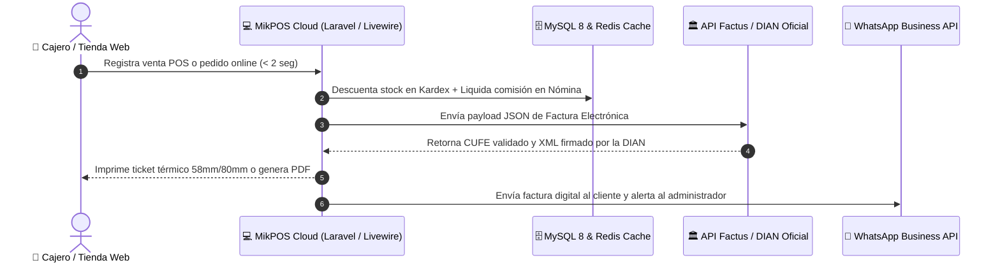
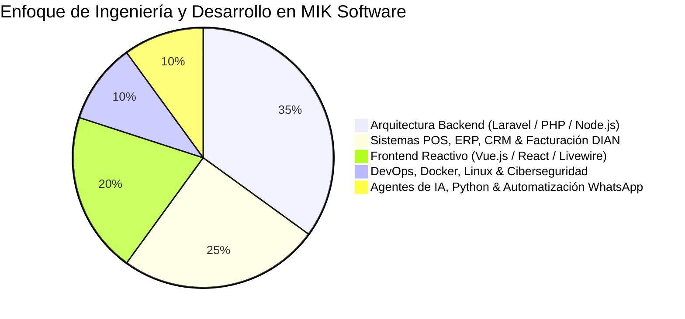
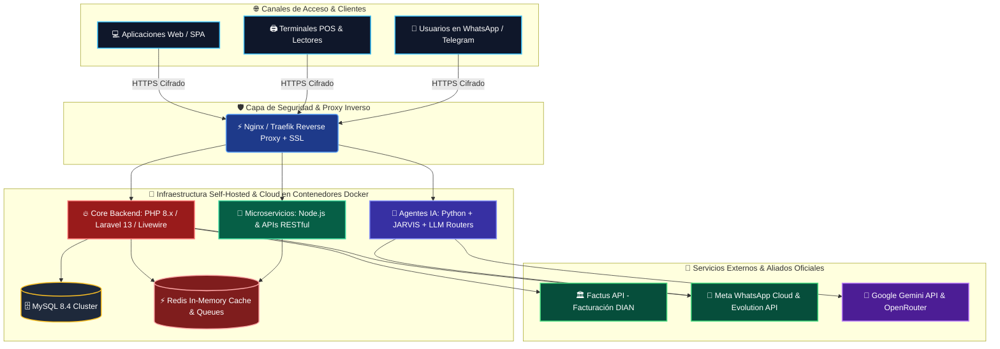
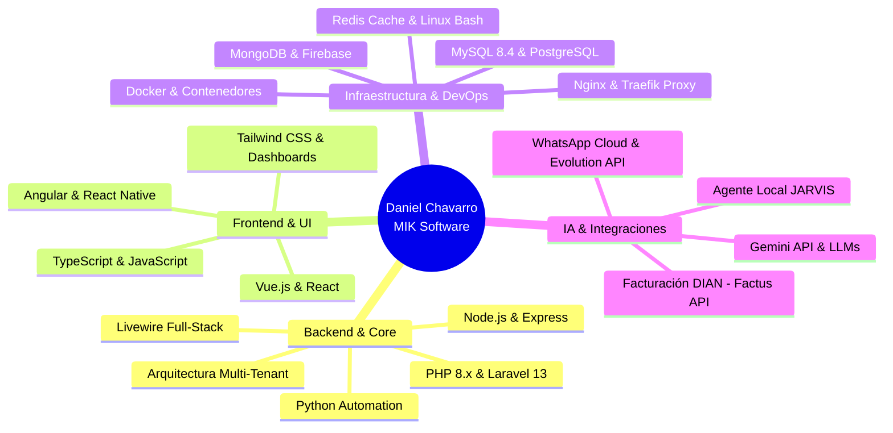

  <!-- TÍTULO DINÁMICO (UN SOLO MOTOR SVG PARA EVITAR IMÁGENES ROTAS) -->
  

  <h3>Transformando Ideas en Ecosistemas Digitales Escalables, Seguros y Automatizados con IA</h3>
  
📍 <b>Bucaramanga, Santander, Colombia</b> &nbsp;|&nbsp; 💼 <b>+8 Años de Experiencia en Ingeniería de Software</b>

  <!-- BOTONES DE CONTACTO Y PLATAFORMAS (URLS REALES Y 100% ESTABLES) -->
  

    
    
    
    
    
  

  <!-- MÉTRICAS DE IMPACTO COMERCIAL -->
  

    
    
    
    
    
  

---

### 👨‍💻 Perfil Ejecutivo & Liderazgo Técnico

Soy **Daniel David Chavarro Quimbaya**, desarrollador de software Full-Stack con **más de 8 años de trayectoria profesional** construyendo software crítico y **CEO & Fundador de [MIK Software](https://miksoftwarecol.com)**, agencia de desarrollo de software e innovación tecnológica con sede en Bucaramanga, Colombia.

Me especializo en diseñar, blindar y desplegar desde cero arquitecturas empresariales de alto tráfico, combinando el ecosistema moderno de **PHP / Laravel (v10–v13)**, **Node.js**, **Python**, **Vue.js** y **React** con infraestructura contenerizada en **Docker**, bases de datos optimizadas en **MySQL / Redis** e Inteligencia Artificial aplicada a procesos de negocio reales.

- 🛡️ **Ciberseguridad & Blindaje Digital:** Auditoría proactiva contra vulnerabilidades críticas (como mitigación de vectores en PHP y bases de datos), aislamiento de contenedores, monitoreo continuo con IA y protección de datos financieros.
- 🧠 **Automatización & Agentes IA:** Desarrollo de asistentes autónomos locales como **JARVIS** (integrado con Gemini API, Python y Telegram), chatbots con contexto real en WhatsApp (Meta Cloud API & Evolution API) y predicción de inventarios.
- ⚡ **Filosofía de Ingeniería:** Código limpio, despliegues automatizados mediante scripts personalizados (`deploy.sh`), cero dependencia de plantillas genéricas y soluciones adaptadas 100% al flujo operativo de cada empresa.

 

---

### 🚀 Producto Insignia: [MikPOS — Sistema POS 100% Web & Facturación DIAN](https://miksoftwarecol.com/mikpos)

En **[MIK Software](https://miksoftwarecol.com/mikpos)** creamos **MikPOS**, el ecosistema Todo en Uno en la nube que centraliza la operación comercial de supermercados, restaurantes, droguerías, tiendas de ropa, ferreterías y comercios minoristas con emisión de comprobantes **en menos de 2 segundos** y **usuarios/cajas ilimitadas**:

| Módulo de Ingeniería | Capacidades Técnicas e Impacto en el Negocio |
| :--- | :--- |
| 🧾 **Facturación Electrónica DIAN** | Integración oficial vía API con **Factus Colombia**, cumpliendo el 100% de la normativa DIAN en tiempo real (incluye paquete de 1.600 documentos/año en el plan DIAN Pro). |
| 📦 **Inventarios, Lotes y Kardex** | Control exacto de entradas, salidas, variantes (tallas, colores, marcas), control por gramaje, alertas de stock mínimo crítico e importación masiva por Excel. |
| 👥 **Módulo de Nómina Interna** | Gestión de turnos, horarios, cálculo de sueldos, comisiones automáticas por ventas y adelantos de caja integrados directamente sin pagar software externo. |
| 🛒 **Tienda Online Sincronizada** | Catálogo web e-commerce conectado en tiempo real al stock físico para recibir pedidos por internet sin riesgo de sobreventa ($0 costo adicional). |
| 🏢 **Multisucursal & Multicaja** | Administración centralizada de múltiples sedes, arqueos ciegos, impresión térmica (58mm y 80mm), lectores de códigos de barras y medios de pago combinados (Efectivo, Nequi, Daviplata, Datáfono, Crédito). |

#### 🔄 Flujo Transaccional de Alta Velocidad en MikPOS

---

### 🏛️ Portafolio de Servicios y Soluciones en [MIK Software](https://miksoftwarecol.com)

1. **Plataformas SaaS Multi-Tenant (Laravel 13):** Sistemas en la nube para gestión de salones de belleza, barberías y centros de servicios con agendamiento dinámico en línea, liquidación compleja de comisiones por profesional y aislamiento seguro por cliente.
2. **Sistemas CRM & Software a Medida:** Plataformas corporativas para seguimiento de clientes, control de cartera y créditos, generación de +10 tipos de reportes financieros (P&G, rentabilidad, compras) y conciliación automatizada de soportes de pago por lotes ZIP.
3. **Dashboard Analytics & API Development:** Paneles interactivos de inteligencia de negocios con métricas en vivo y desarrollo de APIs RESTful de alta disponibilidad para conectar ecosistemas móviles y web.
4. **Landing Pages de Alta Conversión & E-Commerce:** Páginas de aterrizaje optimizadas para SEO técnico, velocidad de carga extrema y conversión directa a WhatsApp.

#### 📊 Distribución de Especialidades e Impacto Técnico

---

### 🏗️ Arquitectura de Infraestructura & Despliegue Cloud

---

### 🛠️ Ecosistema & Stack Tecnológico Completo

| **Backend & Lenguajes** | **Frontend & Mobile** | **DevOps, Bases de Datos & Cloud** |
| :---: | :---: | :---: |
|  |  |  |
|    |    |  |

#### 🧠 Mapa Mental de Dominio Técnico

---

### 📈 Estadísticas de Actividad en GitHub

  

---

### 🤝 ¿Buscas un Desarrollador Full-Stack Senior o un Aliado Tecnológico?

Estoy disponible para liderar desafíos de ingeniería de software, arquitecturas en Laravel/Vue/React/Docker y consultoría técnica (**Remoto** a nivel global, o **Presencial / Híbrido** en el área metropolitana de Bucaramanga), así como para implementar **MikPOS** o desarrollar sistemas empresariales a la medida a través de **[MIK Software](https://miksoftwarecol.com)**.

  
  &nbsp;
  
  &nbsp;
  

